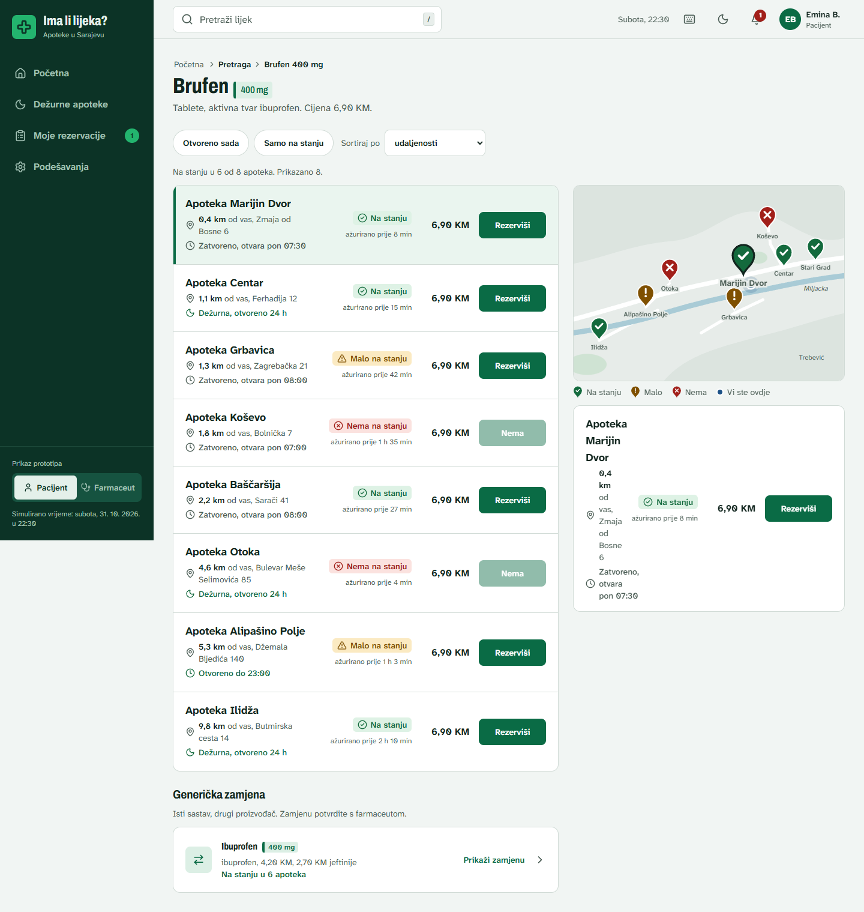
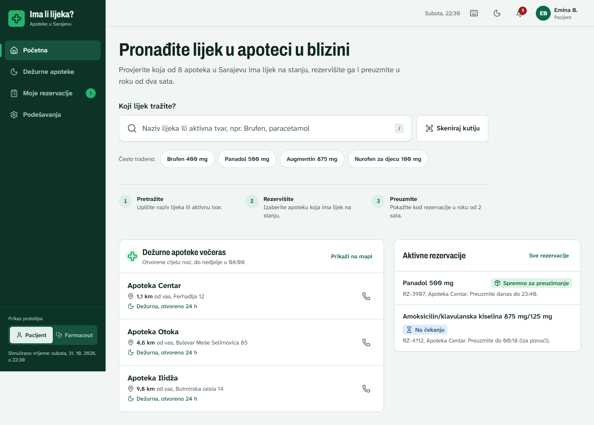
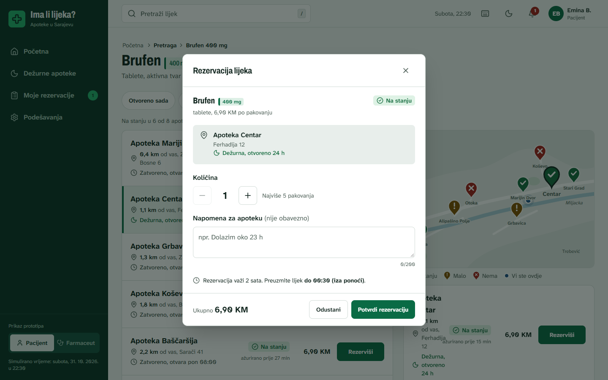
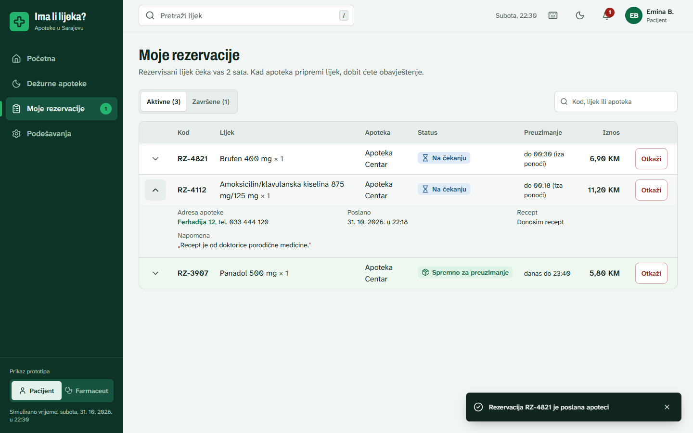
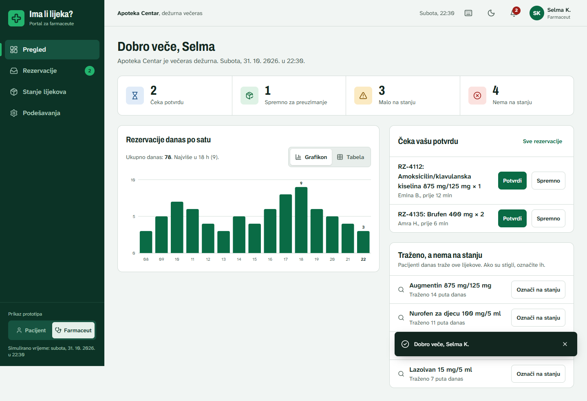
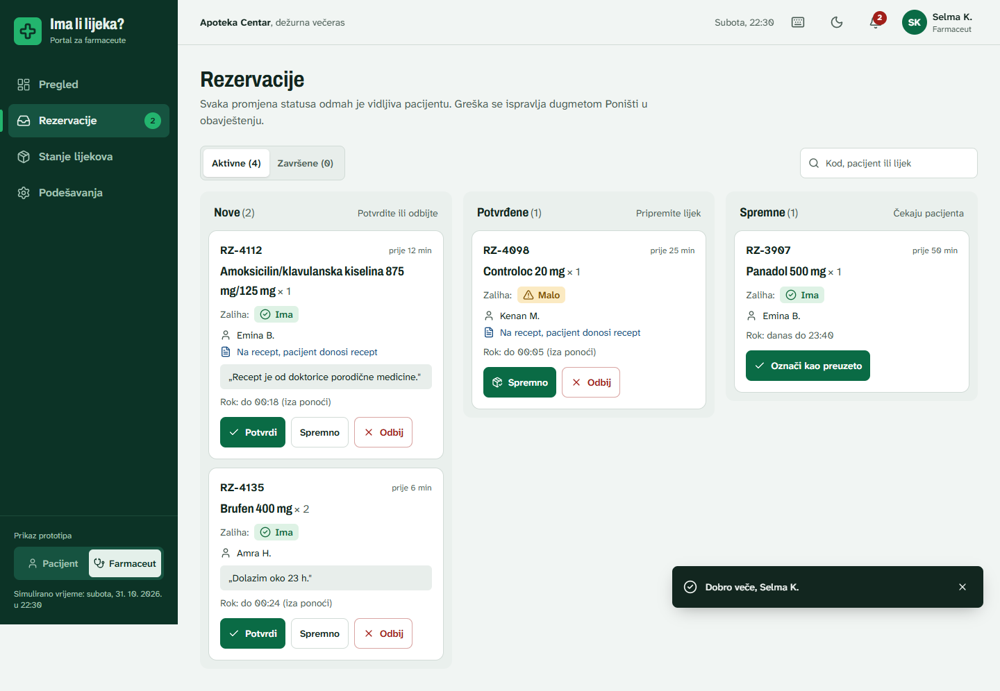
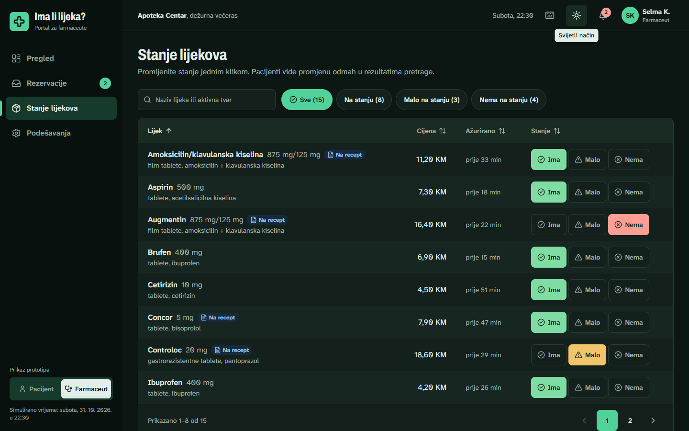

# Ima li lijeka?

Klikabilni hi-fi prototip **web aplikacije** za pronalazak i rezervaciju lijekova u apotekama u Sarajevu. Napravljen je za seminarski rad iz predmeta **Interakcija čovjek-računar**.

Prototip nema backend: svi podaci su izmišljeni i nalaze se u `src/data/mockData.ts`. Rezervacije i promjene zaliha postoje dok klikate, a reload stranice ih vraća na početno stanje. Pamte se samo podešavanja (veličina teksta, tema, kontrast, zvuk). Vrijeme je fiksirano na **subotu, 31. 10. 2026. u 22:30**, da filter „Otvoreno sada" i dežurne apoteke imaju smisla.



## Pokretanje

Potreban je Node.js 20 ili noviji.

```bash
npm install
npm run dev       # otvorite http://localhost:5173
npm run build     # provjera tipova + produkcijski build u dist/
npm run preview   # pregled produkcijskog builda
```

Aplikacija je pravljena za desktop (1280 px i šire), a radi i na tabletu i mobitelu: bočna navigacija se tada sklapa u meni, a lista i mapa se prebacuju segmentnim prekidačem. Uloga (**Pacijent / Farmaceut**) mijenja se u dnu bočne navigacije ili u korisničkom meniju.

## Ekrani

### Pacijent

| Ekran | Putanja | Šta pokazuje |
|-------|---------|--------------|
| Početna | `/pacijent` | Velika pretraga s prijedlozima (radi i bez dijakritika), „Skeniraj kutiju" (simulacija, prepozna Brufen 400), često traženi lijekovi, dežurne apoteke i aktivne rezervacije. |
| Rezultati | `/pacijent/pretraga?lijek=…` | Lista apoteka i mapa jedna uz drugu (prelazak mišem preko reda označi pin). Filteri, sortiranje, stanje filtera u URL-u. Ako lijeka nema nigdje, nudi se generička zamjena. |
| Rezervacija | dijalog | Količina, recept, napomena, ukupna cijena, rok. Uspjeh se prikazuje u istom dijalogu s kodom rezervacije. |
| Detalj apoteke | `/pacijent/apoteka/:id` | Mrvice, traženi lijek, tabela svih zaliha s filterom, radno vrijeme i mini-mapa. |
| Moje rezervacije | `/pacijent/rezervacije` | Tabela s „Vidi više" redovima, Aktivne / Završene, pretraga, otkazivanje uz potvrdni dijalog. |
| Dežurne apoteke | `/pacijent/dezurne` | Lista i mapa dežurnih apoteka. |
| Podešavanja | `/pacijent/podesavanja` | Veličina teksta, tamni način, visoki kontrast, zvukovi, vraćanje podataka prototipa. |

### Farmaceut (Apoteka Centar, Selma K.)

| Ekran | Putanja | Šta pokazuje |
|-------|---------|--------------|
| Prijava | `/farmaceut/prijava` | Podijeljeni ekran, prijava jednim dugmetom (bez lozinke). |
| Pregled | `/farmaceut` | Pokazatelji (čeka potvrdu, spremno, malo, nema), grafikon rezervacija po satu (s tabelarnim prikazom), rezervacije koje čekaju potvrdu, lijekovi koji se traže a nema ih. |
| Rezervacije | `/farmaceut/rezervacije` | Tabla s kolonama Nove / Potvrđene / Spremne, akcije jednim klikom uz „Poništi" u obavještenju, tabela završenih. |
| Stanje lijekova | `/farmaceut/zalihe` | Tabela sa sortiranjem kolona, filterima, paginacijom i promjenom stanja (Ima / Malo / Nema) jednim klikom. |

Svi snimci ekrana su u [`docs/ekrani/`](docs/ekrani/).

| | |
|---|---|
|  |  |
|  |  |
|  |  |

## HCI principi i obrasci u prototipu

| Princip / obrazac | Gdje |
|---|---|
| Globalna navigacija, dosljedan vizuelni okvir | Bočna navigacija i zaglavlje isti na svim ekranima, aktivna stavka istaknuta. |
| Dvopanelni odabir | Rezultati: lista lijevo, mapa desno, povezane prelaskom mišem. |
| Mrvice (breadcrumbs) | Rezultati i detalj apoteke. |
| Napredna pretraga, filtriranje, sortiranje | Prijedlozi u pretrazi, filteri i sortiranje (stanje u URL-u), sortiranje kolona u tabeli zaliha. |
| Paginacija, zebra tabele | Stanje lijekova. |
| Više na zahtjev | „Vidi više" u Mojim rezervacijama. |
| Kontrolna tabla (dashboard) | Pregled farmaceuta. |
| Obavještenja | Zvono s brojem nepročitanih za obje uloge; promjena statusa kod farmaceuta šalje obavijest pacijentu. |
| Oporavak od greške (undo) | „Poništi" u obavještenju nakon svake farmaceutove akcije. |
| Sprječavanje grešaka | Potvrdni dijalog za otkazivanje (fokus na sigurnoj opciji), onemogućeno „Rezerviši" kad nema lijeka, ograničena količina. |
| Povratna informacija | Toast obavještenja (sa zvukom), skeleton učitavanje, prazna stanja s prijedlogom šta dalje. |
| Prečice na tastaturi | `/` fokusira pretragu, `?` otvara listu prečica, `Esc` zatvara dijaloge. |
| Pristupačnost | Ciljevi ≥ 44 px, WCAG AA kontrast, vidljiv fokus, link „Preskoči na sadržaj", status uvijek bojom + ikonom + tekstom, tamni način, visoki kontrast, 3 veličine teksta. |
| Efikasnost | Rezervacija u 3 klika od početne strane. |

## Scenariji za demonstraciju

- **Rezervacija u 3 klika:** Početna → „Brufen 400 mg" (1) → „Rezerviši" kod Apoteke Centar (2) → „Potvrdi rezervaciju" (3).
- **Nema nigdje, ima zamjena:** pretražite *Augmentin*.
- **Nema nigdje, bez zamjene:** pretražite *Ventolin*.
- **Nema rezultata:** upišite npr. *xyz* i pritisnite Enter.
- **Veza dvije uloge:** rezervišite lijek u Apoteci Centar → Farmaceut → Prijavi se → Rezervacije → „Spremno" → Pacijent → zvono s obaviješću.
- **Undo:** kod farmaceuta potvrdite rezervaciju pa kliknite „Poništi".
- **Pristupačnost:** Podešavanja → najveći tekst + tamni način ili visoki kontrast; navigacija samo tastaturom.

## Tehnologije

React 19, Vite, TypeScript, Tailwind CSS v4, React Router, lucide-react (ikone), fontovi Atkinson Hyperlegible Next (tekst, dizajniran za čitljivost) i Archivo (naslovi i nazivi lijekova). Mapa je ručno nacrtan SVG; ne koriste se Google Maps ni Leaflet. Grafikon je vlastiti SVG, boje su provjerene na kontrast za svijetlu i tamnu temu.
